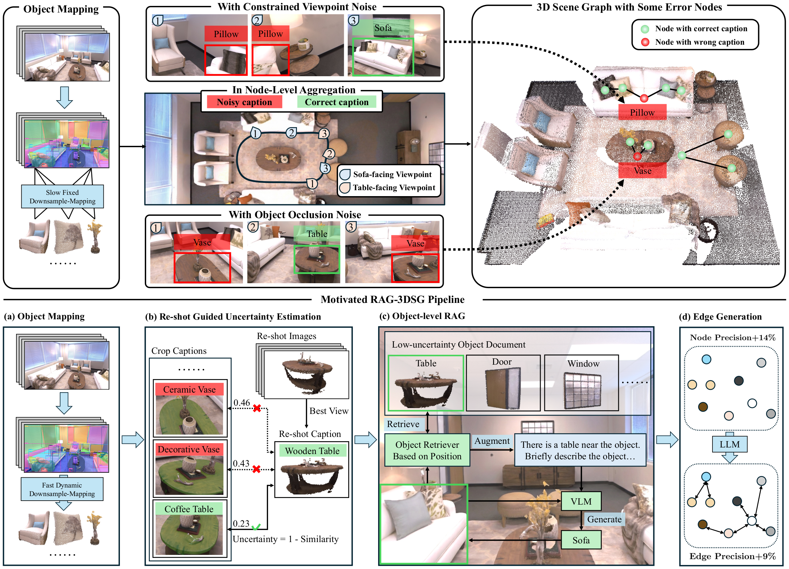
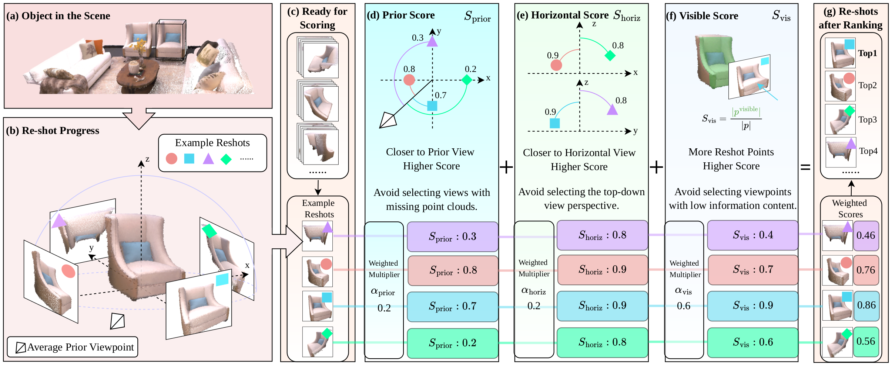
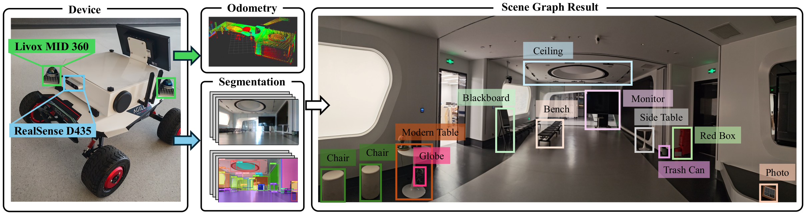

# RAG-3DSG: Enhancing 3D Scene Graphs with Re-Shot Guided Retrieval-Augmented Generation

<div align="center">

[**Paper**](https://doi.org/10.1007/978-3-032-37350-2_13) |
[**arXiv**](https://arxiv.org/abs/2601.10168) |
[**Replica Demo**](#replica-room0-demo) |
[**Citation**](#citation)

Yue Chang, Rufeng Chen, Zhaofan Zhang, Yi Chen, Yifan Tian, Sihong Xie

**ECCV 2026**

</div>

<p align="center">
  
</p>

RAG-3DSG builds an open-vocabulary 3D scene graph from posed RGB-D observations. It actively renders a re-shot view for each reconstructed object, diagnoses semantic uncertainty by comparing passive-view and re-shot captions, and retrieves nearby reliable objects as context to rectify uncertain nodes.

## Method

RAG-3DSG consists of three stages:

1. **Dynamic 3D object mapping.** SAM generates class-agnostic masks, CLIP extracts semantic features, and RGB-D observations are fused using scale-adaptive point-cloud downsampling.
2. **Re-shot guided object-level RAG.** Candidate viewpoints are ranked by prior-view, horizontal-view, and visibility scores. Caption agreement estimates object uncertainty; reliable nearby objects then provide retrieval context for uncertain nodes.
3. **Scene-graph construction.** Refined object captions form the graph nodes, while adaptive geometric connectivity and a constrained language-model prompt produce spatial edges.

<p align="center">
  
</p>

### Real-world deployment

The method was also deployed on a mobile robot using RGB-D perception and LiDAR-IMU odometry.

<p align="center">
  
</p>

## Repository layout

```text
Rag3DSG/
├── assets/             # Paper figures used by this README
├── configs/            # Public one-scene configurations
├── scripts/            # Replica demo runner
└── rag3dsg/
    ├── dataset/        # Posed RGB-D loaders
    ├── segmentation/   # SAM masks and CLIP features
    ├── merging/        # Dynamic downsampling and cross-frame fusion
    ├── reshot/         # Candidate-view scoring and rendering
    ├── graph/          # Uncertainty, object-level RAG, nodes, and edges
    ├── visualization/  # Interactive object and scene-graph viewer
    └── utils/          # Geometry, model, visualization, and prompt utilities
```

## Setup

The mapping and graph stages follow the software stack of [ConceptGraphs](https://github.com/concept-graphs/concept-graphs). Our reference GPU environment uses Ubuntu, Python 3.10, CUDA 11.8, PyTorch 2.0.1, and PyTorch3D 0.7.4.

### GPU environment: mapping and graph generation

Create the Conda environment:

```bash
conda env create -f environment.yml
conda activate rag3dsg
```

Install the CUDA 11.8 / PyTorch 2.0.1 build of PyTorch3D:

```bash
conda install \
  https://anaconda.org/pytorch3d/pytorch3d/0.7.4/download/linux-64/pytorch3d-0.7.4-py310_cu118_pyt201.tar.bz2
```

Install Chamfer Distance and the `conceptfusion` revision of GradSLAM outside this repository:

```bash
mkdir -p third_party
cd third_party

git clone https://github.com/krrish94/chamferdist.git
cd chamferdist
git checkout ee753899b583bdc06bd2505dc162fd54ba0c6c5b
pip install .
cd ..

git clone https://github.com/gradslam/gradslam.git
cd gradslam
git checkout 59ca872e3d265ad09f63c4793d011fad67064452
pip install .
cd ../..
```

Install Segment Anything from the Grounded-Segment-Anything revision used by ConceptGraphs:

```bash
cd third_party
git clone https://github.com/IDEA-Research/Grounded-Segment-Anything.git
cd Grounded-Segment-Anything
git checkout a4d76a2b55e348943cba4cd57d7553c354296223
pip install -e segment_anything
cd ../..
```

Download `sam_vit_h_4b8939.pth` following the [Grounded-Segment-Anything instructions](https://github.com/IDEA-Research/Grounded-Segment-Anything) and place it at:

```text
checkpoints/sam_vit_h_4b8939.pth
```

Finally, install RAG-3DSG:

```bash
pip install -e .
```

The re-shot stage uses Open3D's GUI/GLFW `Visualizer` and requires a working display and OpenGL context.

## API configuration

Node and edge caption generation use an OpenAI-compatible vision/language endpoint. Credentials are read from environment variables and must not be written into YAML files:

```bash
export OPENAI_API_KEY="your-api-key"

# Optional: another OpenAI-compatible endpoint.
export OPENAI_BASE_URL="https://api.openai.com/v1"
```

Model names, timeouts, and the credential environment-variable names are configured in [`configs/replica_example.yaml`](configs/replica_example.yaml).

## Public configurations

- [`configs/replica_example.yaml`](configs/replica_example.yaml): the complete `room0` demo described below.
- [`configs/final_visual.yaml`](configs/final_visual.yaml): interactive visualization of the Replica demo output.
- [`configs/fungraph_example.yaml`](configs/fungraph_example.yaml): a one-sequence FunGraph3D method configuration.
- [`configs/scenefun3d_example.yaml`](configs/scenefun3d_example.yaml): a one-sequence SceneFun3D method configuration.

Dataset-specific camera parameters are kept in [`rag3dsg/dataset/configs/`](rag3dsg/dataset/configs/).

## Replica `room0` demo

The demo uses the posed Replica RGB-D trajectories released by [NICE-SLAM](https://github.com/cvg/nice-slam), following the same data source used by ConceptGraphs.

### 1. Prepare Replica

Download Replica using the [NICE-SLAM download script](https://github.com/cvg/nice-slam/blob/master/scripts/download_replica.sh), then place or symlink the dataset at `data/Replica`:

```text
data/Replica/
└── room0/
    ├── traj.txt
    └── results/
        ├── frame000000.jpg
        ├── depth000000.png
        └── ...
```

The demo configuration processes `room0` with stride 5. Camera intrinsics and depth scaling are defined in [`rag3dsg/dataset/configs/replica.yaml`](rag3dsg/dataset/configs/replica.yaml).

Before running models, inspect all resolved paths without loading any checkpoints:

```bash
python scripts/run_replica_demo.py \
  --stage mapping \
  --config configs/replica_example.yaml \
  --dry-run
```

### 2. Build the object map on the GPU machine

This command runs SAM segmentation, CLIP feature extraction, and dynamic 3D object fusion:

```bash
python scripts/run_replica_demo.py \
  --stage mapping \
  --config configs/replica_example.yaml
```

It produces the merged objects under:

```text
outputs/Replica/replica_demo/room0/merging_method/
```

### 3. Render re-shot views

Run the re-shot stage in a graphical session with a working OpenGL context:

```bash
python scripts/run_replica_demo.py \
  --stage reshot \
  --config configs/replica_example.yaml
```

The stage writes rendered images and a portable manifest:

```text
outputs/Replica/replica_demo/room0/reshot_method/
├── reshot_images/
├── reshot_manifest.json
└── reshot_objects/          # Compatibility cache
```

Paths in `reshot_manifest.json` are relative to the artifact directory. It also records a hash of the merged-object file so that the graph stage can detect results from a different scene.

### 4. Generate graph nodes and edges

With `OPENAI_API_KEY` configured, run the fixed five-stage node-caption pipeline followed by edge generation:

```bash
python scripts/run_replica_demo.py \
  --stage graph \
  --config configs/replica_example.yaml
```

The complete demo output is organized as:

```text
outputs/Replica/replica_demo/room0/
├── segmentation_method/
├── merging_method/
├── reshot_method/
│   ├── reshot_images/
│   └── reshot_manifest.json
├── node_rag3dsg/
└── edge_rag3dsg/
```

The final relations are saved at:

```text
edge_rag3dsg/json_file/final_relations.json
```

### 5. Inspect the 3D scene graph

After graph generation, start the interactive Open3D viewer:

```bash
python -m rag3dsg.visualization.final_visual \
  --config configs/final_visual.yaml
```

The example configuration points to the Replica `room0` demo outputs. For another run, edit `result_path` and `edge_file` in the YAML or override them with `--result-path` and `--edge-file`. Relative paths are resolved from the repository root.

Viewer controls:

- `G`: show or hide scene-graph nodes and relation edges.
- `I`: color the object point clouds by instance.
- `R`: restore the original RGB colors.
- `Q`: close the viewer.

## Run individual method stages

The demo runner calls the following public modules directly; they can also be invoked separately when integrating RAG-3DSG into another pipeline:

```bash
python -m rag3dsg.segmentation.segmentation_sam --config configs/replica_example.yaml
python -m rag3dsg.merging.merge_seg_result_dynamic --config configs/replica_example.yaml
python -m rag3dsg.reshot.reshot_pcd --config configs/replica_example.yaml
python -m rag3dsg.graph.node_caption --config configs/replica_example.yaml
python -m rag3dsg.graph.edge_caption --config configs/replica_example.yaml
```

## Citation

If you find this work useful, please cite:

```bibtex
@inproceedings{chang2026rag,
  title={Rag-3dsg: Enhancing 3d scene graphs with re-shot guided retrieval-augmented generation},
  author={Chang, Yue and Chen, Rufeng and Zhang, Zhaofan and Chen, Yi and Tian, Yifan and Xie, Sihong},
  booktitle={European Conference on Computer Vision},
  pages={223--240},
  year={2026},
  organization={Springer}
}
```

## Acknowledgements

This implementation builds on [ConceptGraphs](https://github.com/concept-graphs/concept-graphs), [Segment Anything](https://github.com/facebookresearch/segment-anything), [OpenCLIP](https://github.com/mlfoundations/open_clip), [GradSLAM](https://github.com/gradslam/gradslam), and [LLaVA](https://github.com/haotian-liu/LLaVA). Please follow the licenses and citation requirements of these projects and the datasets you use.

## License

Released under the [MIT License](LICENSE). Portions derived from ConceptGraphs retain its original MIT notice; see [NOTICE](NOTICE).

##  More Words

This codebase was originally developed on top of [ConceptGraphs](https://concept-graphs.github.io/) (2024). Since then, 3D scene understanding pipelines have evolved rapidly, and the current implementation may not directly align with more recent pipelines.

 Nevertheless, we believe the core **ReShot mechanism** remains a useful and general idea. As also discussed during the review process, ReShot is not necessarily limited to point-cloud-based representations and could potentially be integrated with other scene representations, such as **3D Gaussian Splatting (3DGS)**. We hope this repository can serve as a reference for exploring these directions.


## Our Recent Work on 3D Scene Graphs
If you are interested in more recent developments from us on **3D Scene Graphs (3DSGs)**, we recommend checking out:

* **JITOMA — Just-In-Time Scene Graph Growth: Combating Perceptual Saturation in Long-Horizon Robotics**
  A just-in-time 3DSG framework that dynamically grows task-relevant scene representations for long-horizon embodied agents.
  📄 [arXiv](https://arxiv.org/abs/2607.13245)

* **PSG-Nav — Probabilistic Scene Graph Navigation via Multiverse Decision Making** *(ICML 2026)*
  A downstream application of 3DSGs to open-vocabulary navigation, explicitly modeling perceptual uncertainty with probabilistic scene graphs.
  🌐 [Project Page](https://psg-nav.github.io/) · 📄 [arXiv](https://arxiv.org/abs/2606.01313)

We hope these follow-up works may also be useful to researchers interested in exploring 3DSGs.

